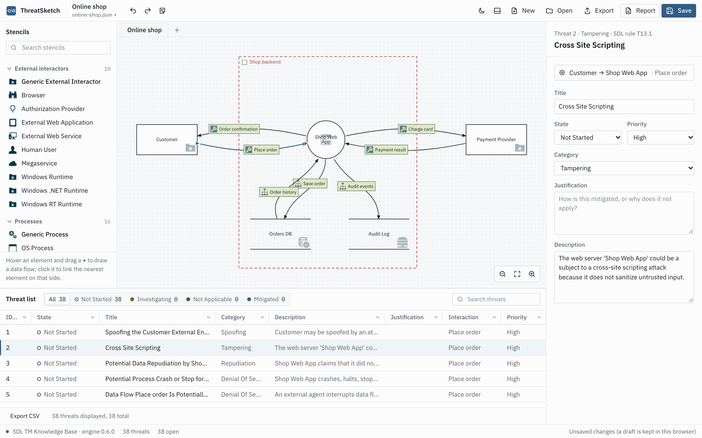
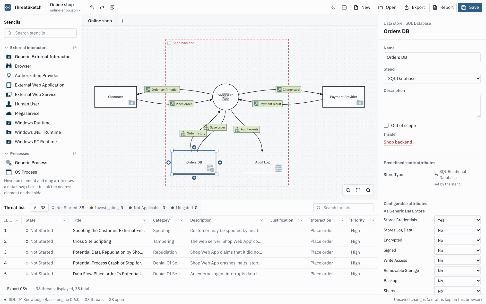
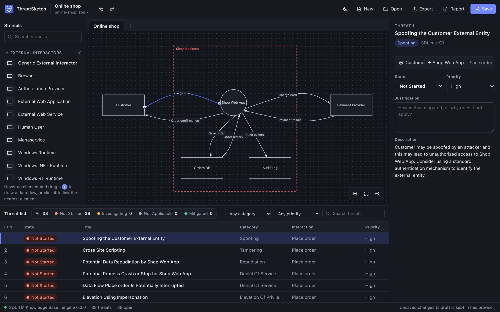
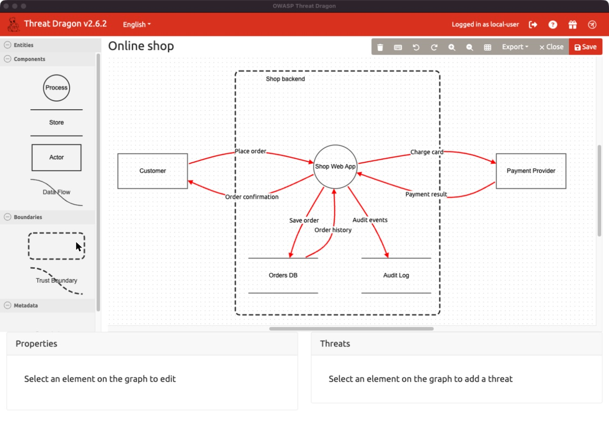
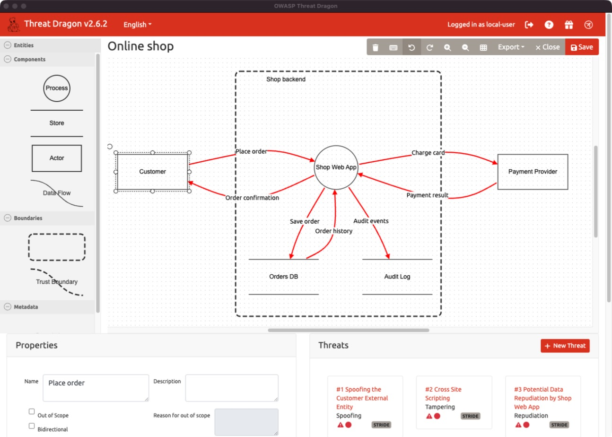

# ThreatSketch and tdtm

[](https://github.com/ElikplimSunu/tdtm/actions/workflows/ci.yml)

Microsoft's Threat Modeling Tool (TMT) generates STRIDE threats from a data-flow diagram, but only
runs on Windows. This repository brings the same threat generation to macOS and Linux, with
the same rules (TMT's **SDL TM Knowledge Base** template) and the same threat titles, categories
and priorities.

- **ThreatSketch** (`app/`) is a threat-modelling app in the style of TMT: draw a diagram, see the
  threats appear as you draw, triage them, export a report, a CSV or a TMT `.tm7`. It runs in the
  browser and as a desktop app, and works offline.
- **tdtm** (`src/tdtm/`) is the engine behind it, and a command-line tool that adds TMT's threats
  to [OWASP Threat Dragon](https://owasp.org/www-project-threat-dragon/) models.

> **Status: early development.** On a real model built in TMT 7.3, tdtm produces exactly the same
> 54 threats as TMT, and its CSV export matches TMT's row for row. Diagrams with curves, tags or
> encryption are checked against hand-worked examples only so far. Progress is tracked in
> [docs/PLAN.md](docs/PLAN.md).

## ThreatSketch



- **Draw like TMT, connect like Figma.** TMT's stencils (Web Application, SQL Database, HTTPS
  and the rest of the SDL template) are on the left. Hover an element and a **+** appears on each
  side: drag it to another element to draw a data flow, or click it to link to the nearest
  element on that side.
- **Threats as you draw.** A moment after each change, TMT's rules run again over the whole diagram,
  including which trust boundaries each flow crosses.
- **TMT's properties.** Pick an element's stencil and set its TMT attributes (Sanitizes Input,
  Authenticates Itself, ...) from the properties pane. Values the stencil fixes are shown locked.
- **Triage the TMT way.** States are Not Started, Needs Investigation, Not Applicable and
  Mitigated, with priority and justification.
- **Hand in what TMT hands in.** A report in the layout of TMT's Full Report, the threat list in
  TMT's CSV format, or a `.tm7` file that opens in TMT.
- **Your files, your computer.** Opens Threat Dragon `.json` and TMT `.tm7` files. Models never
  leave your machine: the engine runs inside the app. Unsaved work is kept as a draft.



It follows your system's light or dark setting (files, reports and exports stay black on white, as in TMT):



### Get it

| Where | How |
|---|---|
| **Browser**, any OS | https://elikplimsunu.github.io/tdtm/ (nothing to install; works offline after the first visit) |
| **macOS** | `brew install --cask elikplimsunu/tap/threatsketch`, or the `.dmg` from [Releases](https://github.com/ElikplimSunu/tdtm/releases/latest) (Intel and Apple silicon) |
| **Windows** | the `.msi` or `-setup.exe` from [Releases](https://github.com/ElikplimSunu/tdtm/releases/latest) |
| **Linux** | the `.AppImage` or `.deb` from [Releases](https://github.com/ElikplimSunu/tdtm/releases/latest) |

The desktop app checks for a new version when it starts and offers to install it; the web
version offers a reload. The apps are not signed by Apple or Microsoft: the first time, macOS
asks you to choose **Open Anyway** in System Settings > Privacy & Security, and Windows shows a
SmartScreen prompt (**More info > Run anyway**).

To run it from a clone (needs [Node.js](https://nodejs.org) 20.19 or newer and
[uv](https://docs.astral.sh/uv/)): `cd app && npm install && npm run dev`, then open
http://localhost:5173. `app/README.md` has the rest.

Already know TMT? [Coming from Microsoft TMT](docs/coming-from-tmt.md) maps every TMT step and
term to ThreatSketch.

## tdtm, the command-line tool

`tdtm open examples/online-shop.json` adds 38 threats to the example model and opens it in
Threat Dragon. Flows that carry open threats are outlined in red:



Select a flow to see its threats, with the same titles and categories TMT would give them:



`tdtm open` also serves an analysis view in your browser, like TMT's Analysis View, and keeps a
TMT-style report next to the model.

### Why a separate tool

TMT's best feature is rule-driven threat generation. Every data flow in the diagram is checked
against the rules in a template, including which trust boundaries the flow crosses. TMT only runs
on Windows.

Threat Dragon runs everywhere and draws the same kind of diagram. It suggests threats one element
at a time and does not look at trust-boundary crossings.

tdtm bridges the two without modifying either. You draw in Threat Dragon. tdtm applies TMT's
**SDL TM Knowledge Base** template and writes the threats back into your model file.

### How it works

```
Threat Dragon: draw the diagram, save model.json
      |
tdtm analyze model.json
  1. read the Threat Dragon v2 JSON
  2. find the trust boundary each element sits in, and the boundaries each flow crosses
  3. read optional @tmt tags from element descriptions (TMT stencils and attributes)
  4. evaluate every TMT threat rule against every data flow
  5. merge the generated threats into the model, keeping anything you edited
      |
Threat Dragon: reopen model.json and triage the threats
```

tdtm follows these rules:

- **Your file loses nothing.** Unknown keys, positions and styling survive a read and write.
- **Re-running is safe.** Generated threats have stable IDs. A threat you edited is never
  overwritten. A threat whose rule stops firing is marked `[stale]`, not deleted. A `.bak` copy is
  written before the model is overwritten.
- **No `eval`.** Template filters go through tdtm's own parser. Nothing from a template or model
  is ever executed.
- **No runtime dependencies.** The core uses only the Python standard library.

### Quick start on a Mac

Install once:

```bash
brew install --cask threat-dragon
uv tool install tdtm                   # or: pipx install tdtm
```

Then one command per model:

```bash
tdtm open model.json      # or model.tm7 to start from a TMT model
```

It creates `model.json` if it does not exist (or converts the `.tm7`, keeping TMT's threats and
your triage), adds the threats TMT would generate, writes `model.report.html` (TMT-style report)
and `model.csv` (TMT's CSV export format) next to it, opens it in Threat Dragon and the
analysis view in your browser, and keeps watching. Draw and save in Threat Dragon; each save updates the threats and both reports. When new
threats arrive, reopen the model in Threat Dragon (File > Open Recent) to see them, or start with
`--reload` to have that done for you. Ctrl-C stops watching.

The same steps one at a time: `tdtm import`, `tdtm analyze`, `tdtm report` (see Usage).

To try it on the example: `tdtm open examples/online-shop.json` from a clone of this repo.
To update tdtm later: `uv tool upgrade tdtm`.

### Install for development

Requires Python 3.11 or newer and [uv](https://docs.astral.sh/uv/).

```bash
git clone https://github.com/ElikplimSunu/tdtm.git
cd tdtm
uv sync
uv run tdtm --help
```

### Usage

```bash
uv run tdtm analyze model.json            # add threats to the model, keeping a .bak copy
uv run tdtm analyze model.json --dry-run  # show what would change
uv run tdtm analyze model.json --prune    # also remove generated threats whose rule stopped firing
uv run tdtm analyze model.json --pack all # also OWASP pytm's threats (needs `uv sync --extra pytm`)
uv run tdtm inspect model.json            # how each element was read: stencil, attributes, zone
uv run tdtm stencils --kind process       # valid @tmt stencils and attributes
uv run tdtm report model.json             # TMT-style HTML report
uv run tdtm report model.json --out threats.csv  # TMT's own CSV export format
uv run tdtm coverage                      # which rules need @tmt tags to fire
uv run tdtm import model.tm7              # convert a TMT model, keeping TMT's threats and triage
uv run tdtm export model.json             # write a TMT .tm7 you can open in TMT or hand in
uv run tdtm open model.json               # all of the above, opened in Threat Dragon and kept updated
uv run tdtm view model.json               # just the analysis view (TMT's threat grid) in the browser
```

Re-running is safe: threats you edited in Threat Dragon keep your changes, and threats whose rule no
longer fires are marked `[stale]` rather than deleted. Only STRIDE diagrams get threats.

#### Working alongside Threat Dragon

Threat Dragon does not notice when a file changes on disk. After tdtm writes the model, close and
reopen it in Threat Dragon before you triage, otherwise Threat Dragon's next save overwrites the
new threats with its older copy. `tdtm analyze model.json --watch` re-runs every time you save, so
the loop is: draw, save, reopen, triage.

#### Telling tdtm what an element really is

Threat Dragon has five generic shapes. TMT has 52 specific stencils, each with attributes the rules
test. tdtm maps Threat Dragon's own properties where it can: an encrypted flow provides
confidentiality and integrity, and a process marked as a web application becomes TMT's Web
Application.

For everything else, add a line starting with `@tmt:` to the element's description:

```
@tmt: WebApp; hasInputSanitizers=Yes
@tmt: SQL Database; storesCredentials=Yes
@tmt: HTTPS
```

A bare word names a stencil, by ID, short ID or name, in any case. `key=value` sets an attribute.
A typo is reported as an error with a suggestion, never silently ignored. `tdtm stencils` lists
every valid value. Tags live in the description because Threat Dragon always keeps that field.

#### Trust boundaries

Draw them as usual. An element is inside a boundary box when its centre is inside the box. A flow
crosses a box when exactly one of its ends is inside, and crosses a boundary curve when the two
lines intersect. Boxes become TMT border boundaries; curves become line boundaries.

## Documentation

- [docs/coming-from-tmt.md](docs/coming-from-tmt.md): TMT steps and terms, mapped to tdtm.
- [docs/SPEC.md](docs/SPEC.md): design, file format facts, rule semantics, merge behaviour.
- [docs/PLAN.md](docs/PLAN.md): roadmap and task list with acceptance criteria.

## Development

```bash
uv sync
uv run pytest -q
uv run ruff check . && uv run ruff format --check .
uv sync --extra pytm   # optional OWASP pytm rule pack (`--pack pytm`); CI installs it

cd app
npm run check          # type-check the app
npx vitest run         # unit tests
npx playwright test    # end-to-end tests against the production build, in Chrome
```

The app runs tdtm's Python engine unchanged, in the browser, through
[Pyodide](https://pyodide.org); `src/tdtm/api.py` is everything it calls. `app/README.md`
explains how the app is put together.

Work follows `docs/PLAN.md` from top to bottom, one task per commit. Tests come first, written from
the task's acceptance criteria. A task that teaches something new about the file formats updates
`docs/SPEC.md` in the same commit.

## Releasing

One version number covers tdtm and ThreatSketch ([semantic versioning](https://semver.org)).
Note changes under *Unreleased* in [CHANGELOG.md](CHANGELOG.md) as you go. To release:

```bash
uv run python scripts/bump.py 0.4.0       # sets the version everywhere, dates the changelog
git commit -am "Release 0.4.0" && git tag v0.4.0 && git push && git push --tags
```

The tag starts `.github/workflows/release.yml`: tests; desktop builds for macOS, Windows and
Linux, each opened and checked by a self-test; the GitHub release with every installer and the
update feed; then the website, the Homebrew tap and PyPI. Running the workflow by hand ("Run
workflow") builds and self-tests everything without releasing.

## Contributing

Issues and pull requests are welcome. The most valuable help needs a Windows machine: the real
acceptance test is drawing the four small diagrams in `tests/fixtures/golden/` in TMT 7.3 with the
SDL TM Knowledge Base template and comparing its threat report with tdtm's expected output (PLAN
task 3.4). If you can run TMT, please open an issue.

## License

MIT, see [LICENSE](LICENSE). Bundled third-party material:

- `src/tdtm/data/templates/default.tb7`: Microsoft
  [threat-modeling-templates](https://github.com/microsoft/threat-modeling-templates), MIT.
- `tests/fixtures/td/` and `tests/fixtures/schema/`: sample models and the v2 JSON schema from
  [OWASP Threat Dragon](https://github.com/OWASP/threat-dragon), Apache-2.0.
- ThreatSketch's diagram shapes are adapted from OWASP Threat Dragon (Apache-2.0); its web build
  bundles AntV X6 and Svelte (MIT) and Pyodide (MPL-2.0).

Details in [THIRD_PARTY_NOTICES.md](THIRD_PARTY_NOTICES.md). ThreatSketch and tdtm are not
affiliated with Microsoft or OWASP.
