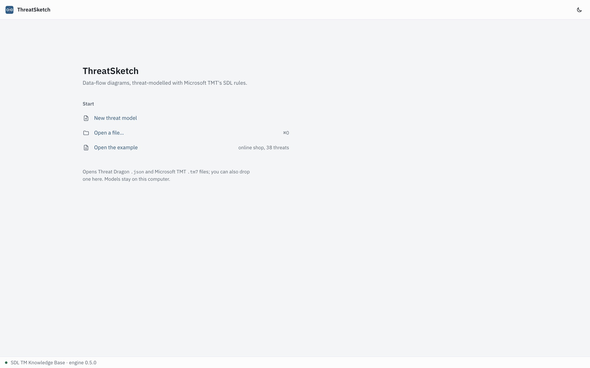
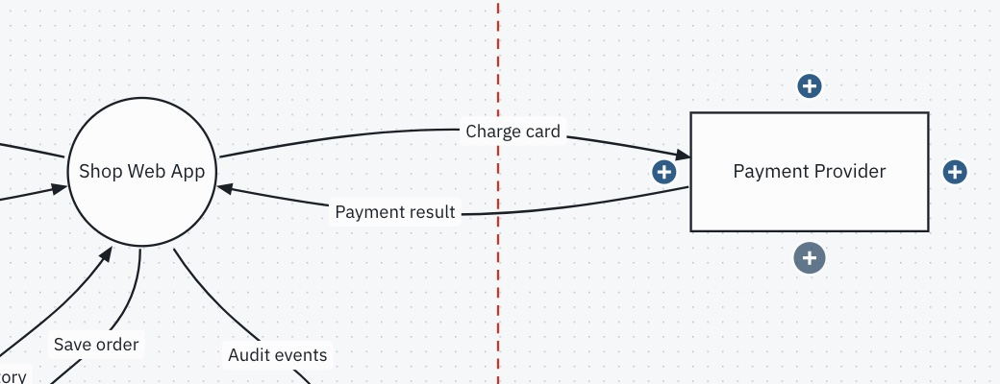
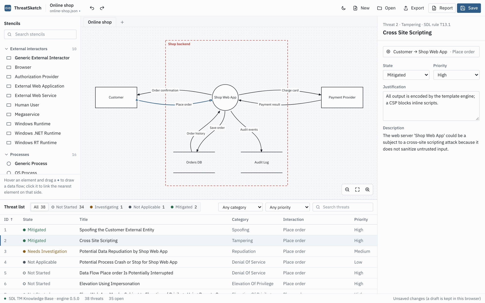
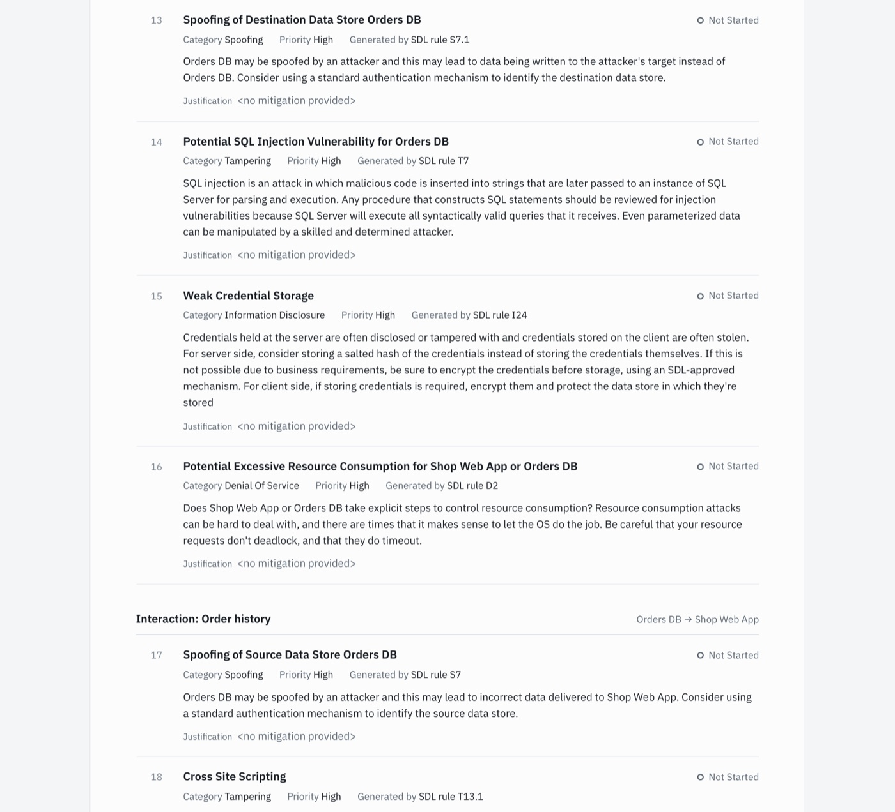
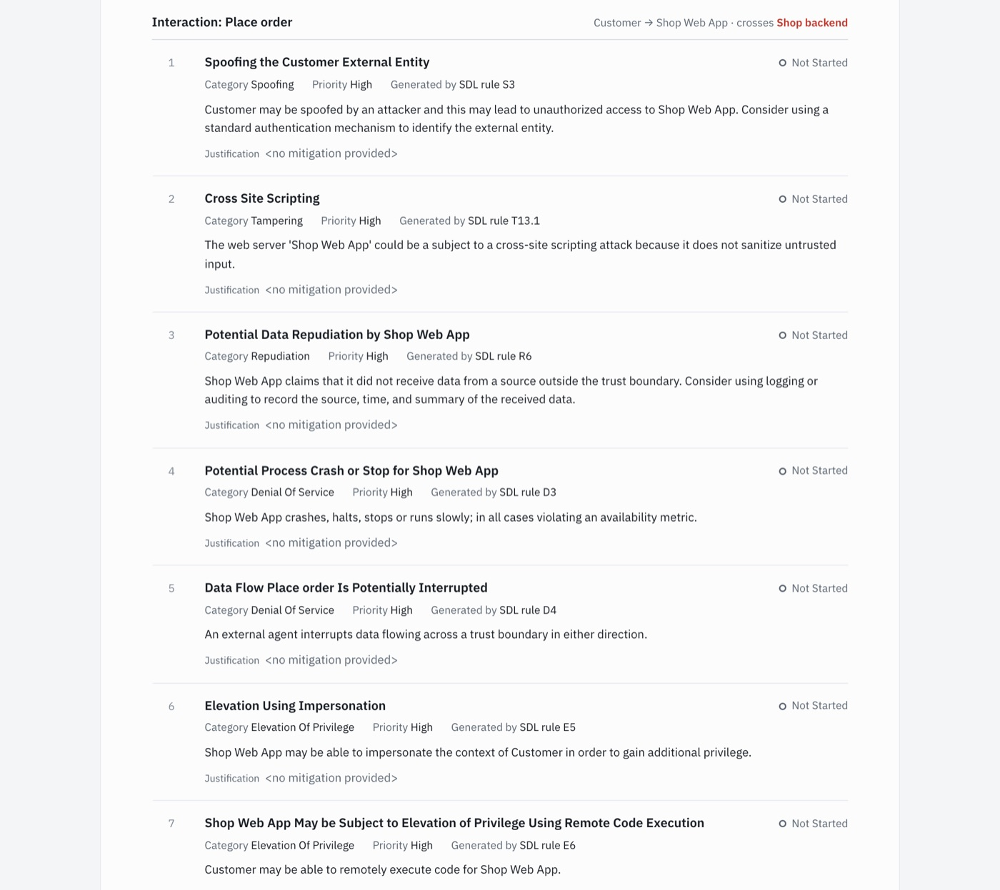

# ThreatSketch

[](https://github.com/ElikplimSunu/threatsketch/actions/workflows/ci.yml)

Threat modelling in the style of Microsoft's Threat Modeling Tool (TMT), for macOS, Windows,
Linux and the browser. Draw a data-flow diagram; the STRIDE threats from TMT's **SDL TM
Knowledge Base** template appear as you draw, with TMT's titles, categories and priorities.


## Install

| Where | How |
|---|---|
| Browser, any system | https://elikplimsunu.github.io/threatsketch/ (works offline after the first visit) |
| macOS | `brew install --cask elikplimsunu/tap/threatsketch`, or the `.dmg` from [Releases](https://github.com/ElikplimSunu/threatsketch/releases/latest) (Intel and Apple silicon) |
| Windows | the `.msi` or `-setup.exe` from [Releases](https://github.com/ElikplimSunu/threatsketch/releases/latest) |
| Linux | the `.AppImage` or `.deb` from [Releases](https://github.com/ElikplimSunu/threatsketch/releases/latest) |
| Command line | `uv tool install threatsketch` or `pipx install threatsketch` ([guide](docs/command-line.md)) |

The desktop app offers new versions when it starts; the web version offers a reload. The apps are
not signed by Apple or Microsoft, so the first launch needs one extra step: on macOS, **Open
Anyway** in System Settings > Privacy & Security; on Windows, **More info > Run anyway**.

Used TMT before? [Coming from Microsoft TMT](docs/coming-from-tmt.md) maps each TMT step to
ThreatSketch.

## What it does

- **TMT's stencils and rules.** Web Application, SQL Database, HTTPS and the rest of the SDL
  template, with each stencil's TMT properties. Threats depend on the stencils, their properties
  and which trust boundaries each flow crosses, as in TMT.
- **Connecting.** Hover an element: a **+** appears on each side. Drag it to another element to
  draw a data flow, or click it to link the nearest element on that side. Flows stay on the sides
  you chose, curved as in TMT or as elbow lines.
- **Triage.** Not Started, Needs Investigation, Not Applicable and Mitigated, with priority and
  justification.
- **Hand-ins.** A report laid out like TMT's Full Report (HTML or PDF), the threat list in TMT's
  CSV format, or a `.tm7` for TMT. A review list flags what a reader would trip over first, such
  as elements still named Process or Data flow.
- **Files.** Opens Threat Dragon `.json` and TMT `.tm7`; saves Threat Dragon `.json`, which Threat
  Dragon also opens. Nothing is uploaded: the threat engine runs on your computer.

## A tour

**Start.** New model, open a file, or the example. Unsaved work from last time is offered here.



**Draw and connect.** Hover an element for a **+** on each side; drag it to another element, or
click it to link the nearest one. A flow stays on the sides you chose, and two flows between the
same elements bow apart, as in TMT. Under Line in a flow's properties, choose curved or elbow.



**TMT properties.** Pick the element's stencil and set its TMT properties. Values fixed by the
stencil are shown locked; the trust boundary it sits in is named in red.


**Triage.** Set state, priority and justification. Threats nobody has looked at stay quiet in the
list; the ones you have decided on stand out.



**Report.** The threat report follows TMT's Full Report: a summary by state and by STRIDE
category, the diagram, then every interaction, the boundaries it crosses, and its threats. It
prints to A4 with page numbers; Export > Threat report (PDF) saves it as a PDF
([example PDF](docs/example-report.pdf)). The Export menu
also has the HTML report, TMT's CSV and a `.tm7`.





**Dark mode** follows your system. Files, reports and exports stay black on white, as in TMT.


## How close it is to TMT

Checked against a real model built in TMT 7.3 with the SDL template: the same 54 threats, the CSV
export identical row for row, and the `.tm7` back unchanged after import and export.

Not yet compared with TMT itself: line boundaries, stencil properties other than the defaults,
encrypted or HTTPS flows, out-of-scope elements, two-way flows, and TMT opening a `.tm7` exported
from a diagram drawn here. These follow TMT's own rules and are checked against worked examples.
If you can run TMT, comparing them is the most useful contribution (see Contributing).

## Documentation

- [docs/coming-from-tmt.md](docs/coming-from-tmt.md): TMT steps and terms, mapped to ThreatSketch.
- [docs/command-line.md](docs/command-line.md): the `threatsketch` command, with OWASP Threat Dragon.
- [app/README.md](app/README.md): how the app is built, and its design rules.
- [docs/SPEC.md](docs/SPEC.md): design, file format facts, rule semantics, merge behaviour.
- [docs/PLAN.md](docs/PLAN.md): roadmap and task list with acceptance criteria.

## Development

```bash
uv sync
uv run pytest -q
uv run ruff check . && uv run ruff format --check .
uv sync --extra pytm   # optional OWASP pytm rule pack (`--pack pytm`); CI installs it

cd app
npm run check          # type-check the app
npx vitest run         # unit tests
npx playwright test    # end-to-end tests against the production build, in Chrome
```

The app runs the Python engine (`src/threatsketch`) unchanged, in the browser, through
[Pyodide](https://pyodide.org); `src/threatsketch/api.py` is everything it calls. `app/README.md`
explains how the app is put together.

Tests come first. A change that teaches something new about the file formats updates
`docs/SPEC.md` in the same commit. `main` only accepts changes whose CI passes.

## Releasing

One version number covers the app and the command ([semantic versioning](https://semver.org)).
Note changes under *Unreleased* in [CHANGELOG.md](CHANGELOG.md) as you go. To release:

```bash
uv run python scripts/bump.py 0.4.0       # sets the version everywhere, dates the changelog
git commit -am "Release 0.4.0" && git tag v0.4.0 && git push && git push --tags
```

The tag starts `.github/workflows/release.yml`: tests; desktop builds for macOS, Windows and
Linux, each opened and checked by a self-test; the GitHub release with every installer and the
update feed; then the website, the Homebrew tap and PyPI. Running the workflow by hand ("Run
workflow") builds and self-tests everything without releasing.

## Contributing

Issues and pull requests are welcome. The most valuable help needs a Windows machine: the real
acceptance test is drawing the four small diagrams in `tests/fixtures/golden/` in TMT 7.3 with the
SDL TM Knowledge Base template and comparing its threat report with ThreatSketch's expected output (PLAN
task 3.4). If you can run TMT, please open an issue.

## License

MIT, see [LICENSE](LICENSE). Bundled third-party material:

- `src/threatsketch/data/templates/default.tb7`: Microsoft
  [threat-modeling-templates](https://github.com/microsoft/threat-modeling-templates), MIT.
- `tests/fixtures/td/` and `tests/fixtures/schema/`: sample models and the v2 JSON schema from
  [OWASP Threat Dragon](https://github.com/OWASP/threat-dragon), Apache-2.0.
- The diagram shapes are adapted from OWASP Threat Dragon (Apache-2.0). The app bundles AntV X6,
  Svelte and Tauri (MIT), Pyodide (MPL-2.0) and IBM Plex (OFL-1.1).

Details in [THIRD_PARTY_NOTICES.md](THIRD_PARTY_NOTICES.md). ThreatSketch is not
affiliated with Microsoft or OWASP.
